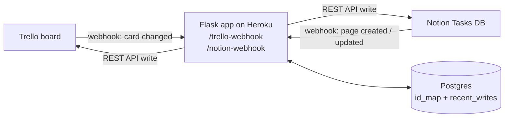

# Trello ↔ Notion Two-Way Sync

A small, self-hosted Python service that keeps a **Trello board** and a **Notion task database** in two-way sync in real time, using both platforms' webhooks and REST APIs.

> **Context:** I built and deployed this during a business-analyst internship, where the team ran day-to-day work in Trello and kept its project tracker in Notion. This repository is a **sanitised portfolio copy**, shared with permission. All organisation-specific identifiers, credentials, URLs, names, and workspace data have been removed, and the commit history is new.

---

## What it does

| Change made in… | What happens automatically |
|---|---|
| **Trello:** move a card to another list | The matching Notion task's **Status** updates |
| **Trello:** change a card's due date or project label | Notion **Due Date** / **Project** relation updates |
| **Trello:** create a card | A new Notion task is created and linked |
| **Notion:** change a task's Status, Due Date or Project | The Trello card moves list / updates date / swaps label |
| **Notion:** create a new task | A new Trello card is created and linked |

It runs continuously on Heroku for a few dollars a month. Before this, keeping both tools aligned meant updating two systems by hand every time a task changed. A paid no-code sync tool was piloted first to prove the concept, then replaced by this custom build for lower running cost and full control over how fields map.

### Field mapping

| Trello | ↔ | Notion (Tasks database) |
|---|---|---|
| Card name | | Title property |
| List | | `Status`: Notion's **status** type, which has a different API shape from **select** |
| Due date | | `Due Date` |
| Label (matched by name) | | `Project`: a **relation** to a separate Projects database |

Property names are configurable via environment variables (see `schema.py`), so the service can point at any Notion database with this shape.

---

## Architecture



1. A platform sends a webhook to the app saying *something changed*.
2. The app fetches the current state of that card or page through the API. Webhook payloads only tell you *what* changed, so the app always reads the latest state itself.
3. `field_mapping.py` translates it into the other platform's shape. This is pure logic with no network calls.
4. The app writes to the other platform, records the Trello-ID ↔ Notion-ID link, and fingerprints the write so the echo it triggers is ignored.

| File | Responsibility |
|---|---|
| `app.py` | Flask routes and the sync orchestration for both directions |
| `field_mapping.py` | Pure, network-free translation between Trello fields and Notion properties |
| `mapping_store.py` | ID-mapping table and echo/loop prevention. Postgres in production, SQLite locally |
| `trello_client.py` / `notion_client_custom.py` | Thin REST API wrappers |
| `schema.py` | Notion property names, overridable by environment variable |
| `config.py` | Loads credentials and settings from the environment |
| `backfill_existing_tasks.py` | One-off script that links tasks created before the tool went live (dry run by default) |
| `register_trello_webhook.py` | One-off helper that registers the Trello webhook |
| `tests/` | 34 unit tests. Every API is mocked, so no network or credentials are needed |

---

## Engineering problems worth reading about

Most of these were found **after** launch, from real production logs. Each fix has a regression test.

### 1. Infinite sync loops (echo detection)
Every write the app makes triggers a webhook on the *other* platform, which would trigger another write, and so on forever. The app stores a fingerprint of each write it makes (status, due date and sorted project IDs) for 10 seconds, and skips incoming events that match.

**The bug:** the two sync directions built that fingerprint from *different* data shapes: raw Notion properties in one direction, raw Trello fields in the other. The hashes could never match, so echoes were never caught, and a card moved once could ping-pong and look as if it had reverted by itself. **The fix** was one canonical, direction-independent fingerprint (`canonical_fingerprint`), plus a test proving both directions produce identical output for the same state.

### 2. Stale metadata cache
List, label and project lookups were cached once at startup, so a list added to the board later was invisible until a restart. A card moved into it had its Status silently cleared. **Fix:** a 5-minute TTL, plus a forced refresh and retry when an unknown list ID turns up.

### 3. The invisible trailing space
One project's label suddenly stopped syncing. The cause was a trailing space in the Notion project title, which is invisible in the UI and breaks an exact string match. **Fix:** whitespace-normalise both sides before matching, and log a warning for any Trello label with no matching Notion project, so mismatches show up instead of failing silently.

### 4. Safe creation in the Notion → Trello direction
Creating a Trello card for "any Notion page with no link yet" would have spawned duplicates for every task that existed *before* the tool went live, the first time anyone edited one. **Fix:** cards are created only when Notion's event type is `page.created`. An edit to an unlinked old task is logged and skipped. Six tests cover this gate, including a missing event type and a redelivered event.

### 5. Self-healing when a linked page is deleted
If someone deleted a Notion page that was still linked to a Trello card, every later update to that card crashed with a 4xx, on every retry. **Fix:** a 4xx on update means the link is stale, so the app clears it and creates a fresh page. A 5xx is still raised, so a Notion outage can't trigger mass re-creation.

### 6. Backfill without duplicates
Linking the pre-existing tasks needed a one-off script. Its dry run (the default) showed that several tasks would have got **duplicate** cards, because matching cards had already been created by hand. **Fix:** check every title against all existing cards on the board and *link* to a match instead of creating a copy. Re-runs are safe because already-linked tasks are skipped.

### 7. Deployment lessons
- Heroku's filesystem is wiped on every dyno restart, so a SQLite mapping table would be lost regularly and cause duplicates. Production uses Postgres. SQLite remains only for local development.
- `psycopg2-binary` had no wheel for the platform's default Python at the time, so the build failed. Python is pinned to 3.12 in `.python-version`.

---

## Running it yourself

### 1. Local setup
```bash
git clone https://github.com/<your-username>/trello-notion-sync.git
cd trello-notion-sync
python3 -m venv venv && source venv/bin/activate
pip install -r requirements.txt
cp .env.example .env   # then fill in your own values
```

### 2. Notion
1. Create an **internal integration** and copy its secret into `NOTION_TOKEN`.
2. You need two databases: **Tasks** (title, `Status` of type *status*, `Due Date`, `Project` relation) and **Projects** (title).
3. Share **both** databases with the integration. Sharing a parent page does not always share the databases inside it.
4. Put each database's `data_source_id` into `.env`.

### 3. Trello
1. Create a Power-Up / API key and generate a token. Copy both into `.env`.
2. Make the board's **list names** match your Notion Status options exactly, and the **label names** match your Notion project titles.

### 4. Test
```bash
python -m unittest -v      # 34 tests, no network or credentials needed
```

### 5. Deploy (Heroku example)
```bash
heroku create <app-name>
heroku addons:create heroku-postgresql:essential-0
heroku config:set TRELLO_API_KEY=... TRELLO_TOKEN=... TRELLO_BOARD_ID=... \
                  NOTION_TOKEN=... NOTION_TASKS_DATA_SOURCE_ID=... NOTION_PROJECTS_DATA_SOURCE_ID=...
git push heroku main
```

### 6. Register the webhooks
```bash
# Trello
python register_trello_webhook.py https://<your-app>.herokuapp.com/trello-webhook
```
For Notion, add a webhook subscription in the integration's settings that points to `https://<your-app>.herokuapp.com/notion-webhook`, subscribed to *page created* and *page properties updated*. Notion sends a one-time verification token, which the app prints to its logs (`heroku logs --tail`). Paste it back into Notion to activate the subscription.

---

## Known limitations

- **Deletion isn't synced.** Archiving a card or deleting a page on one side doesn't remove its partner. Archiving is the recommended workflow.
- **Assignee and description** aren't synced by default. Description sync can be switched on with `SYNC_DESCRIPTION=true`.
- **Card order within a list** isn't synced.
- Notion batches webhook events, so changes made in Notion can take up to about a minute to reach Trello. Trello → Notion is near-instant.
- If two Trello cards share an identical name, the backfill's name-matching links to only one of them.

## Tech stack
Python 3.12 · Flask · gunicorn · requests · PostgreSQL (psycopg2) / SQLite · Trello REST API & webhooks · Notion API (`2026-03-11`, data sources) & webhooks · Heroku · unittest + `unittest.mock`

---

*Author: Diana Zagrebina*
